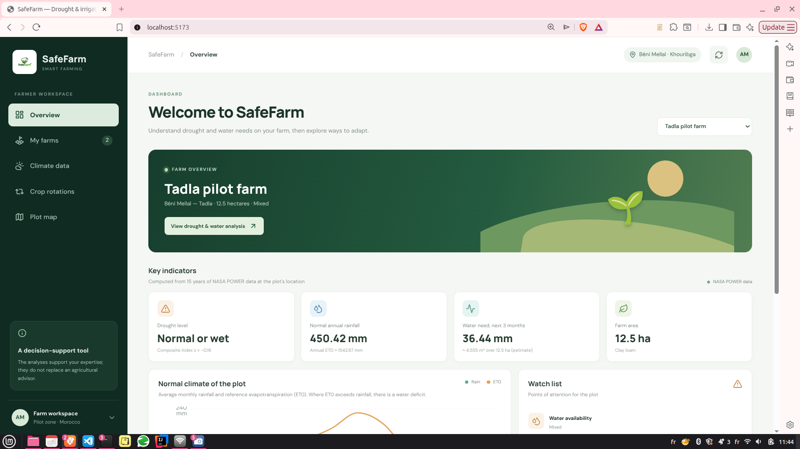
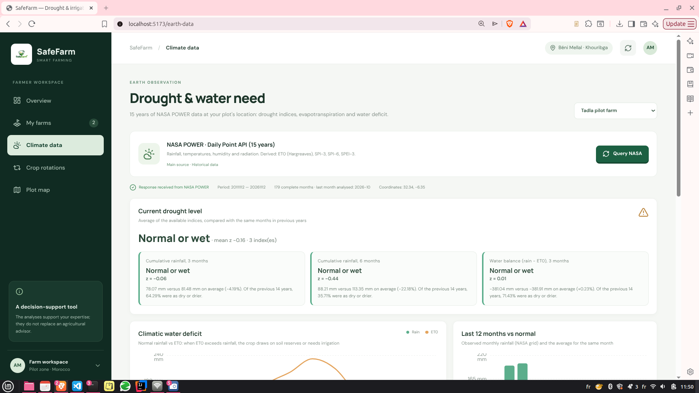
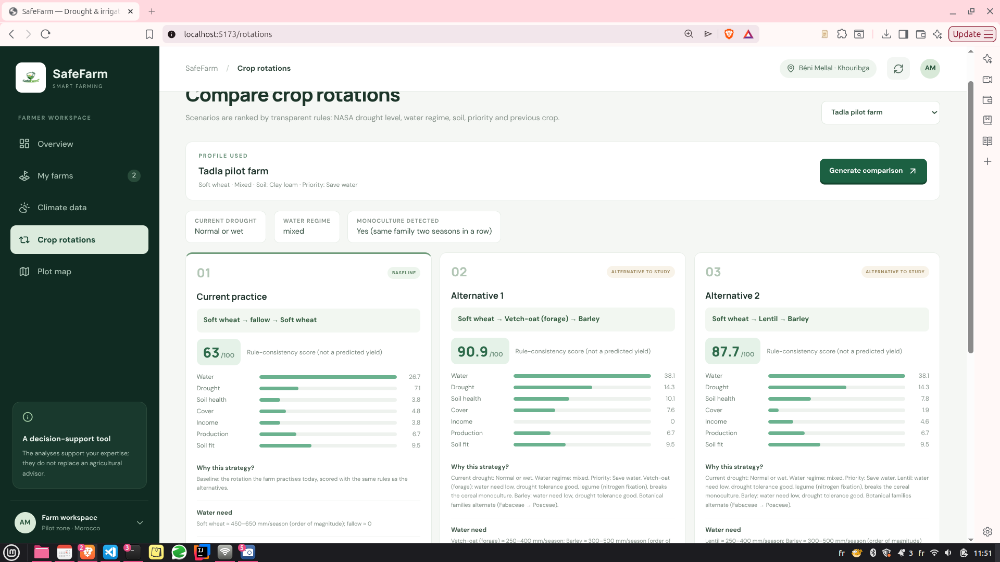

# SafeFarm

**Drought and irrigation decision support for farmers in Morocco, built on NASA POWER data.**
NASA Space Apps Challenge 2026 — _Adapting Farms with NASA Data_ · Pilot zone: Béni Mellal / Tadla and Khouribga.

> SafeFarm is an exploratory decision-support prototype. It does **not** forecast drought and it does **not** replace a local agronomist. Every limit is stated in the app and in this document.

## The problem

Morocco is going through repeated multi-year droughts. Farmers in rain-fed and mixed systems must decide, season after season, **what to plant and how much water they will really need**, usually without access to long-term climate data for their own plot. Satellite and reanalysis data exist, but they are hard to read for a farmer.

## What SafeFarm does

A farmer registers a plot (GPS position, area, soil, water regime, current/previous crop, priority). The backend then queries NASA for the plot's coordinates and returns:

| Output                                 | How it is computed                                                                                                                                                                                    |
| -------------------------------------- | ----------------------------------------------------------------------------------------------------------------------------------------------------------------------------------------------------- |
| **Drought level**                      | Simplified **SPI-3, SPI-6 and SPEI-3**: z-score of the last 3/6 months of rainfall (or rainfall − ET0) against the same months in the previous ≤15 years. Averaged into one level (normal → extreme). |
| **Climatic water deficit**             | Monthly **ET0** (Hargreaves-Samani, FAO-56) vs monthly rainfall, as a 12-month climatology and as the last 12 months vs normal.                                                                       |
| **Irrigation outlook (next 3 months)** | `max(0, Kc × ET0 − normal rainfall)` per month for the plot's current crop, converted to m³/ha and m³ for the whole plot (1 mm = 10 m³/ha).                                                           |
| **Rotation comparison**                | The current practice vs two alternatives, each with a transparent 0–100 rule-based score (see below), reasons, water need, risks, benefits and a confidence label.                                    |

### How the rotation scores work (no black box)

Each candidate crop gets a score from seven weighted factors: water fit, drought tolerance, soil health (legume / cover), soil cover, income, production, and soil suitability. The weights change with the farmer's stated **priority** (save water, limit drought losses, improve soil, reduce erosion, diversify income) and with the **current drought severity**. Hard rules: rain-fed plots exclude the thirstiest crops, and consecutive crops must belong to different botanical families. The catalogue (10 crops + fallow) is a generic agronomic simplification in `RotationService.java`.
The score measures _consistency with these rules_, not a predicted yield.

## NASA data and other sources actually used

| Source                                                                                                                  | Status                                                               | Use                                                                  |
| ----------------------------------------------------------------------------------------------------------------------- | -------------------------------------------------------------------- | -------------------------------------------------------------------- |
| **NASA POWER** Daily Point API (AG community) — `T2M`, `T2M_MAX`, `T2M_MIN`, `PRECTOTCORR`, `RH2M`, `ALLSKY_SFC_SW_DWN` | **Integrated** (15 years of daily data, queried live and cached 6 h) | Rainfall, temperature, ET0, drought indices                          |
| NASA SMAP (soil moisture)                                                                                               | Not integrated yet                                                   | Future work: direct soil-moisture stress                             |
| NASA GPM IMERG (precipitation)                                                                                          | Not integrated yet                                                   | Future work: finer rainfall, cross-check of POWER                    |
| MODIS / VIIRS NDVI, Landsat                                                                                             | Not integrated yet                                                   | Future work: crop vigour, observed stress                            |
| SRTM                                                                                                                    | Not integrated yet                                                   | Future work: slope and erosion risk                                  |
| FAO GAEZ, ESA Sentinel-2, ERA5                                                                                          | Not integrated yet                                                   | Future work: crop suitability, field-scale NDVI, validation of POWER |

Nothing that is not integrated is simulated in the interface.

## Architecture

```
React 18 + Vite  ──REST──►  Spring Boot 3 (Java 17)  ──►  NASA POWER API
 (Leaflet, Recharts)            │  AnalysisService (ET0, SPI/SPEI, outlook)
                                │  RotationService (rule-based scoring)
                                └─► MariaDB / MySQL   (or H2 file DB, zero setup)
```

## Screenshots

Take these with a live backend (real NASA data) and save them under `docs/screenshots/`:

| Page                                                  | File                                 |
| ----------------------------------------------------- | ------------------------------------ |
| Dashboard                                             | `docs/screenshots/dashboard.png`     |
| Drought & water (indices, charts, irrigation outlook) | `docs/screenshots/drought-water.png` |
| Rotation comparison                                   | `docs/screenshots/rotations.png`     |
| Plots map                                             | `docs/screenshots/map.png`           |





## Run it

Requirements: Java 17+, Maven 3.9+, Node 20+. Internet access (the backend calls NASA POWER).

**Backend — zero setup (H2 file database, one demo plot is seeded):**

```bash
cd backend
mvn spring-boot:run -Dspring-boot.run.profiles=h2
```

**Backend — MariaDB / MySQL:**

```sql
CREATE DATABASE safefarm CHARACTER SET utf8mb4 COLLATE utf8mb4_unicode_ci;
```

```bash
cd backend
mvn spring-boot:run            # env: DB_URL, DB_USER, DB_PASSWORD (default root / empty)
```

**Frontend:**

```bash
cd frontend
npm install
npm run dev                    # http://localhost:5173  (optional: VITE_API_URL=http://localhost:8080/api)
```

**Tests** (ET0 sanity, normal vs drought year, short series, rotation reacts to context): `cd backend && mvn test`

API: `GET/POST /api/farms`, `PUT/DELETE /api/farms/{id}`, `GET /api/farms/{id}/analysis`, `GET /api/farms/{id}/rotations`.

## Limits and honest caveats

- POWER is a ~0.5° (≈50 km) grid built from satellite and reanalysis data. It is **not a measurement of the plot**; microclimate and local rain are not captured.
- SPI/SPEI here are **simplified z-scores** on a ≤15-year baseline, not the official gamma / log-logistic fits on 30 years. They are meaningful mostly in the wet season; in dry summer months they are flagged _not significant_.
- ET0 is Hargreaves-Samani (temperature-based), less accurate than Penman-Monteith. Kc values are FAO-56 mid-season constants, so the irrigation outlook is an order of magnitude, not an irrigation schedule. Rainfall is not reduced for runoff or efficiency.
- The rotation catalogue is generic and **not validated locally** (varieties, sowing dates, diseases, markets, seed access). Seasonal water needs are FAO-order-of-magnitude ranges.
- The current-year drought level is only as good as the latest complete month of POWER data (a few days of latency).
- Not yet in the form: budget, target season, yield history and past drought losses.
- Validate every scenario with a local agricultural advisor before acting on it.

## Use of AI

SafeFarm's analysis is **not machine learning**: drought indices and rotation scores are deterministic, documented formulas, so every number can be traced and audited. AI assistance (Github copilot) was used during development to help write and refactor code, tests and documentation; the formulas come from FAO-56 and the SPI/SPEI literature (see References).

## References

- Allen, R.G. et al. (1998). _Crop evapotranspiration — FAO Irrigation and Drainage Paper 56._
- Hargreaves, G.H. & Samani, Z.A. (1985). Reference crop evapotranspiration from temperature. _Applied Engineering in Agriculture._
- McKee, T.B., Doesken, N.J. & Kleist, J. (1993). The relationship of drought frequency and duration to time scales (SPI).
- Vicente-Serrano, S.M. et al. (2010). A multiscalar drought index sensitive to global warming: the SPEI. _Journal of Climate._
- NASA POWER Project, Prediction Of Worldwide Energy Resources — https://power.larc.nasa.gov/

## Team

NASA Space Apps Challenge 2026 — Vision 360° _(Elayane Nora - Omaima khatir)_.
